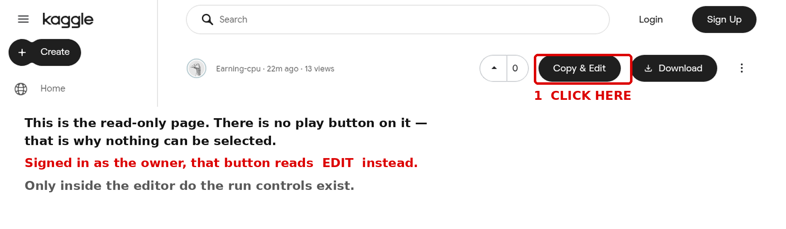

# Running the notebook on Kaggle — exact clicks

I opened the page in a clean browser to see what you are seeing. **There is no run button
because the page you land on is read-only.** It is a preview of the notebook, not the editor.
In the editor everything is different.



---

## Step 0 — use the right link

```
https://www.kaggle.com/code/earningcpu/nightingale-b-roll-wan-ltx-flux-parallax
```

The old `.../nightingale-wan-2-2-b-roll` link is **dead** — I renamed the notebook and Kaggle
issued a new address. Verified: the old one returns *"We can't find that page."* If you have it
bookmarked, delete it.

I also made the notebook **public** just now, so the link works whether or not you are signed in.
You still need to be signed in to *run* anything.

## Step 1 — sign in

Top right → **Sign In**. Use the account **Earning-cpu** (that is the owner of the notebook).

If you are signed out and land on *"We can't find that page"*, that is not a broken link — that is
Kaggle refusing to show a notebook to a visitor who is not signed in.

## Step 2 — click the button at the top right


In the top bar, to the right of the title, there are three black buttons.

| You see | You are | Click |
|---|---|---|
| **Edit** | signed in as the owner | **Edit** |
| **Copy & Edit** | anyone else | **Copy & Edit** |
| *no buttons at all* | the page is still loading, or you are on the dead old link | wait 15 s, then re-check the URL |

**This is the step that is missing.** Until you click it, the page is a picture of a notebook:
nothing can be selected, no cell can be clicked, no play button exists.

## Step 3 — wait for the editor to load

The editor is a heavy app. On a slow connection it can take **one to three minutes** and shows
grey placeholder blocks while it loads. That is normal. Do not click around — a second click while
it loads can open a second tab.

You are in the editor when you can see, down the left of each cell, a small **`[ ]:` execution
marker**.

## Step 4 — three ways to run, pick one

### Way A — Save & Run All (the good one, use this)

1. Top right → **Save Version** (circular arrow icon, blue)
2. A dialog opens with a radio choice
3. Select **"Save & Run All (Commit)"**
4. Click **Save**

This runs the whole notebook top to bottom in a **separate background session**. You can close
the tab and shut the laptop. It shows up as a new version when it finishes. This is the only
option that survives your connection dropping.

### Way B — Run menu (interactive, tab must stay open)

1. Toolbar above the cells → **Run**
2. → **Run all**

Runs in your live session. The tab must stay open, and an idle session closes after **20 minutes**
with no activity. Only use this if you want to watch it happen.

### Way C — one cell at a time

- Click a cell once so it is selected (its border turns blue)
- Press **Ctrl + Enter** (Mac: **⌘ + Enter**) to run it

There is also a **▶** button that fades in at the left edge of a cell when your mouse is over it —
it is small and only appears on hover, which is why you could not see it.

## Step 5 — is it running?

- Bottom of the screen: a status bar shows the kernel state and elapsed time
- The **Session** panel on the right shows GPU / RAM
- With Way A, the notebook version number at the top right increments and the run appears under
  **⋯ → View Versions**

## Step 6 — get the files out

When it finishes:

1. Open the notebook again (the version page)
2. Click the **Output** tab, next to *Notebook / Input / Logs*
3. Download the four `.mp4` files

Then, on your machine:

```bash
python3 tools/compare_clips.py qa/clips --out qa/cmp --height 640
```

---

## If any of that still does not appear — the 3-line fallback

This does not use my notebook at all. It cannot break.

1. Go to **https://www.kaggle.com/code** → **New Notebook** (top right)
2. Kaggle opens a blank notebook with one cell
3. Delete what is in the cell and paste these three lines:

```python
!pip install -q -U "diffusers>=0.35" transformers accelerate "imageio[ffmpeg]"
!git clone -q https://github.com/earning-cpu/nightingale-films.git
!python nightingale-films/tools/kaggle_wan_broll.py --prompt "archival 16mm film, 1979, airfield at night in dense fog, sodium floodlights through mist, wet tarmac, slow drift right, heavy grain, black and white, no people, no text" --size 704x1280 --frames 81 --steps 30 --seed 1979 --out /kaggle/working/wan_scene.mp4
```

4. Right-hand panel → **Settings** (or the ⋮ at the top) → **Accelerator → GPU T4 ×2**, **Internet → On**
5. Press **▶** on that cell, or **Ctrl + Enter**
6. Wait 15–25 minutes. The clip appears in `/kaggle/working/`.

The repository is public, so `git clone` works with no token. Verified: both scripts return
HTTP 200 from GitHub.

---

## Phone or desktop?

| | Works? | Reality |
|---|---|---|
| **Desktop** | ✅ | the only comfortable way. Do it here |
| **Tablet, landscape** | ✅ | cells run; the output panel covers half the screen |
| **Phone** | ⚠️ | the editor *does* load in mobile Chrome, but the top bar is crowded, the per-cell ▶ is ~12 px, pasting a prompt is miserable, and **Save Version** hides under an overflow menu |

The run itself takes 45 minutes of GPU time. The clicking takes one minute. Use a desktop for
that one minute.

---

## The one thing that trips everyone up

**Read-only page → no buttons. Editor → buttons.** Every "I can't find Run" that has ever been
reported on Kaggle is this. Click **Edit** first, then look at the top right.
